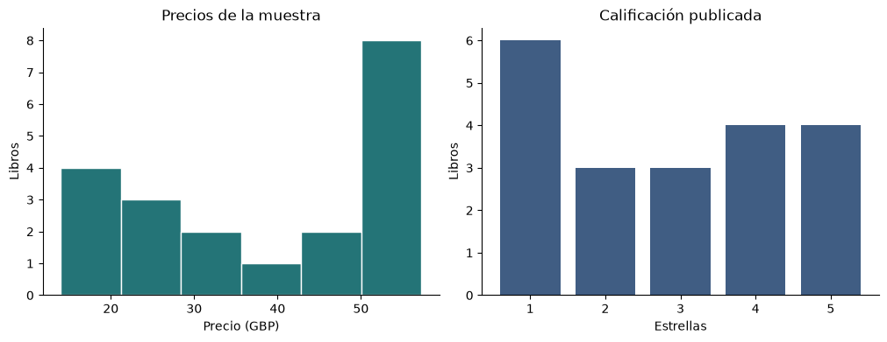

# Books to Scrape · análisis de una página de catálogo

Ejercicio de aprendizaje concluido sobre extracción HTML y análisis exploratorio con Python. El notebook sigue cada ficha desde el HTML hasta una tabla de títulos, precios en libras, disponibilidad y estrellas. **Un precio que falta se conserva como dato ausente.** Así se puede revisar cuántos precios entran en la media y distinguir un error de lectura de un libro con precio £0.00.

[Abrir el notebook con sus resultados](notebooks/project_webscraping_01.ipynb) · [Ver el lector de fichas](src/catalogue.py) · [Consultar la muestra HTML](data/portada.html)

## Resultado de la muestra

En la portada consultada el **2 de noviembre de 2026** había 20 fichas y todas tenían un precio válido. El precio medio fue **£38,05**, la mediana **£41,38** y el intervalo **£13,99 a £57,25**. Los 20 títulos figuraban disponibles. La calificación más frecuente fue una estrella, con 6 de los 20 títulos.



La muestra contiene las cuatro piezas de HTML que lee el ejercicio en cada ficha. Se comprobó que su lectura devuelve los mismos 20 registros que la página completa. El sitio asigna precios y estrellas con fines de práctica. Estas cifras describen una portada de demostración consultada una vez. [Books to Scrape](https://books.toscrape.com/)

## Repetir el análisis

Desde la raíz del repositorio, con Python 3.12 y un entorno virtual activo:

```bash
python -m pip install -r requirements.txt
python -m jupyterlab notebooks/project_webscraping_01.ipynb
```

Ejecuta las celdas en orden. Por defecto se lee la muestra guardada, así que el análisis puede repetirse sin conexión después de instalar las dependencias. Cambia `USAR_WEB` a `True` para consultar la portada actual con HTTPS y un tiempo de espera de 15 segundos. Si el sitio devuelve un error HTTP o la página carece de fichas reconocibles, la ejecución informa el problema.

Para comprobar los casos de precio ausente, precio cero, moneda inesperada, ficha incompleta y página sin fichas:

```bash
python -m unittest discover -s tests -v
```

La [verificación en GitHub](.github/workflows/verify.yml) también ejecuta el notebook completo sobre la muestra local.

## Lugar en el portafolio

Este repositorio conserva un primer ejercicio de scraping. Su alcance termina en la primera página y el análisis descriptivo de esa muestra. El [historial del ejercicio](https://github.com/GzoC/project_webscraping_01/tree/63dd26bddda26178c344c19a56319735f886bdba) conserva la versión original. Para revisar un caso de datos aplicado al mantenimiento industrial, consulta el [proyecto de analítica SQL](https://github.com/GzoC/my_sql_project_01).

El código del ejercicio se distribuye bajo la [licencia MIT](LICENSE).
